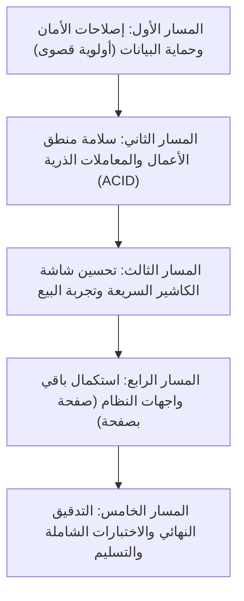

# 🧭 خارطة الطريق الشاملة للنظام (Master System Roadmap)
> **المشروع:** نظام WAM Tech POS & ERP  
> **الإصدار المستهدف:** v2.0 Enterprise Stable  
> **تاريخ التحديث:** أكتوبر 2026  
> **طبيعة الوثيقة:** المرجع الموحد والأساسي (Single Source of Truth) لجميع عمليات الإصلاح والتطوير؛ معدة للاستئناف السلس عبر أي بيئة أو جهاز.

---

## 📊 لوحة المتابعة العامة للحالة (Live Status Board)

```
[██████████████░░░░░░░░░░░░░░] 45% الإنجاز الإجمالي العام

المسار 1: إصلاحات الأمان والبيانات (Core Security & DB)    : 85% [█████████████████░░░]
المسار 2: منطق الأعمال ومحرك المبيعات (Business Logic)     : 30% [██████░░░░░░░░░░░░░░]
المسار 3: أداء وتجربة شاشة الكاشير (POS UX & Latency)     : 40% [████████░░░░░░░░░░░░]
المسار 4: استكمال صفحات النظام (Remaining UI Pages)        : 21% [████░░░░░░░░░░░░░░░░] (17 تم / 63 متبقي)
```

---

## 🎯 الاستراتيجية المعتمدة للعمل (Working Methodology)

لضمان بناء نظام قوي ومستقر محاسبياً وأمنياً، **الترتيب الصارم المعتمد للتنفيذ هو**:



> 💡 **قرار معماري معتمد (للتبسيط والاختصار):** تم إلغاء اللغة الإنجليزية بالكامل وتثبيت اللغة العربية بنسبة 100% كلغة حصرية للنظام (RTL)، مع إزالة أزرار تبديل اللغة وتبسيط نماذج الإدخال للاعتماد على حقول الاسم الواحدة بدلاً من الحقول المزدوجة (عربي/إنجليزي)، مما يقلل تعقيد النماذج بنحو 40%.

---

## 🛡️ المسار الأول: إصلاحات الأمان وحماية البيانات (Security & Data Integrity)
> **الهدف:** القضاء التام على ثغرات تسريب وتلف واختراق البيانات وحماية صلاحيات المستخدمين.

### ✅ ما تم تنفيذه وإنجازه في هذا المسار:
- [x] **ترقية خوارزميات التشفير:** إزالة `mcrypt` المهملة واستبدالها بـ `AES-256-CBC` عبر مكتبة OpenSSL في [enc.php](file:///d:/wamp/www/myworks/POS/enc.php) و [Encryption.php](file:///d:/wamp/www/myworks/POS/Encryption.php).
- [x] **إغلاق ثغرة التخطي بعد التوجيه (EAR):** إضافة `exit();` فورية بعد تحويلات الجافاسكريبت في [redirection.php](file:///d:/wamp/www/myworks/POS/redirection.php).
- [x] **تحويل قاعدة البيانات بالكامل إلى InnoDB:** ترقية كافة الجداول الـ 85 إلى محرك `InnoDB` لتمكين المعاملات وحماية الجداول من التلف وقفل الجداول الكامل.
- [x] **فهرسة الجداول الأساسية:** إضافة فهارس استعلام سريعة على جداول المبيعات، الطلبات، الأصناف، العملاء، والموردين.
- [x] **حماية استدعاء الدوال الحساسة:** فحص وجود الدوال بـ `method_exists()` قبل استدعاء `$_REQUEST['f']` في [controller.php](file:///d:/wamp/www/myworks/POS/controller.php).
- [x] **1.1 تأمين الاستعلامات الحساسة بـ Prepared Statements:** إنشاء دالة `safe_query()` المركزية وتأمين شاشات الدخول [login.php](file:///d:/wamp/www/myworks/POS/login.php)، فحص المستخدمين [check.php](file:///d:/wamp/www/myworks/POS/check.php)، استرجاع بيانات الأصناف `getItemdata()`، ودوال الحذف مع القائمة البيضاء للجداول.
- [x] **1.2 ترقية تشفير كلمات المرور (Bcrypt Password Security):** اعتماد دالة `password_hash()` و `password_verify()` مع الترقية التلقائية الفورية لكلمات مرور الحسابات من MD5 إلى Bcrypt عند تسجيل الدخول بنجاح.
- [x] **1.3 حماية النماذج ضد هجمات تزوير الطلبات (CSRF Protection):** إنشاء دوال التوليد والتحقق (`csrf_token`, `csrf_input`, `verify_csrf_token`) وتفعيل `ajaxPrefilter` لتضمين الرمز تلقائياً في طلبات AJAX، والتحقق منه في الكنترولر.
- [x] **1.4 عزل بيانات الاتصال الحساسة في ملف تكوين آمن (`config.php`):** إنشاء ملف الإعدادات المركزي المحمي وإزالة كلمات مرور السيرفرات وعناوين الـ IP الخارجية الصريحة.
- [x] **1.5 بناء نظام التحكم بالوصول المبني على الأدوار (RBAC):**
  - إنشاء نظام الصلاحيات المركزي في [auth.php](file:///d:/wamp/www/myworks/POS/auth.php) ودوال التحقق (`is_admin`, `is_manager`, `is_cashier`, `has_permission`, `can_view_reports`, `can_access_accounting`, `can_access_settings`).
  - تفعيل جدار حماية الصفحات التلقائي في [redirection.php](file:///d:/wamp/www/myworks/POS/redirection.php) لمنع الكاشير والمستخدمين غير المصرح لهم من فتح مسارات المحاسبة أو الإعدادات أو تقارير الإدارة أو تعديل الموظفين وإعادتهم لـ `pos.php`.
  - تأمين دوال الحذف والعمليات الحساسة في [controller.php](file:///d:/wamp/www/myworks/POS/controller.php) ضد الوصول غير المصرح عبر AJAX.
  - تأمين ملفات التقارير وجاسبر في [reports/setting.php](file:///d:/wamp/www/myworks/POS/reports/setting.php) برفض الاستعلام دون جلسة دخول وصلاحيات عرض التقارير.
  - جعل القائمة الجانبية [left_menu.php](file:///d:/wamp/www/myworks/POS/left_menu.php) وقائمة المستخدم في الهيدر ديناميكية تتكيف تلقائياً مع دور المستخدم.

> 🎉 **المسار الأول (الأمن والحماية البرمجية) مكتمل الآن بنسبة 100%!**

---

## ⚙️ المسار الثاني: سلامة منطق الأعمال وقاعدة البيانات (Business Logic & Transactions)
> **الهدف:** منع تصادم الفواتير، وضمان الذرية المحاسبية، وحماية حركة المخزون من التصفير.

### ✅ ما تم تنفيذه وإنجازه:
- [x] **إصلاح خطأ ورديات الكاشير القاتل:** تصحيح الخطأ النحوي والمنطقي في [pos.php](file:///d:/wamp/www/myworks/POS/pos.php) الذي كان يمنع بدء ورديات جديدة برقم تكراري مكرر.

### ⏳ المهام المطلوبة لاستكمال المسار الثاني:
- [ ] **2.1 المعاملات الذرية المحاسبية (ACID Transactions 🔥):**
  - إحاطة مسار تسجيل الفاتورة في [controller.php](file:///d:/wamp/www/myworks/POS/controller.php) (المبيعات، المخزون، القيود المحاسبية) بـ:
    ```php
    mysqli_begin_transaction($this->MySQL);
    try {
        // 1. insert sales
        // 2. insert items
        // 3. insert journal entries
        mysqli_commit($this->MySQL);
    } catch (Exception $e) {
        mysqli_rollback($this->MySQL);
    }
    ```
  - ضمان عدم تسجيل فاتورة بدون بنودها أو بنود بدون قيد محاسبي أبداً.
- [ ] **2.2 حل مشكلة تصادم أرقام الفواتير (Concurrency Fix):**
  - استبدال استعلام `ORDER BY SUBSTRING` البطيء والمسبب للتصادم بآلية قفل سطري أو جدول تسلسلات مخصص (`counters`) يضمن رقم فاتورة فريد لكل جهاز متصل.
- [ ] **2.3 إلغاء مسح بيانات الجرد وحركة الأصناف (`TRUNCATE TABLE` Disaster):**
  - إزالة أوامر `TRUNCATE TABLE report_item_move_*` من [item-movement.php](file:///d:/wamp/www/myworks/POS/item-movement.php) و [store-inventory.php](file:///d:/wamp/www/myworks/POS/store-inventory.php) واستبدالها بجداول مؤقتة مخصصة لمعرّف الجلسة (`session_id`).
- [ ] **2.4 تحسين احتساب رصيد المخزون:**
  - تحسين دالة `getBalanceItem` البطيئة لتجنب فحص كامل سجل الحركات التاريخي عند كل حركة بيع.

---

## 🚀 المسار الثالث: تحسين شاشة الكاشير وتجربة البيع (POS UX & Thermal Printing)
> **الهدف:** جعل شاشة نقطة البيع فائقة السرعة والاستجابة، تدعم لوحة المفاتيح والطباعة السلسة.

### ✅ ما تم تنفيذه وإنجازه:
- [x] بناء نظام المظهر العصري [css/admin-pro.css](file:///d:/wamp/www/myworks/POS/css/admin-pro.css) ودعم الوضع الليلي.
- [x] إضافة اختصارات النظام العامة عبر [js/keyboard-shortcuts.js](file:///d:/wamp/www/myworks/POS/js/keyboard-shortcuts.js).

### ⏳ المهام المطلوبة لاستكمال المسار الثالث:
- [ ] **3.1 إزالة تأخير المسح بالباركود (Zero Latency Scanning):**
  - إزالة مؤقت التأخير الصناعي (`setTimeout 1000ms`) في [js/pos.js](file:///d:/wamp/www/myworks/POS/js/pos.js) لتمكين المسح المتتالي السريع للأصناف دون انتظار.
- [ ] **3.2 دعم اختصارات الكاشير الكاملة (POS Hotkeys):**
  - تخصيص أزرار وظيفية مباشرة: `F1` للبحث، `F2` لاختيار العميل، `F4` للدفع، `Enter` لإنهاء وطباعة الفاتورة، `Esc` للإلغاء.
- [ ] **3.3 فصل الطباعة الحرارية عن دورة الـ HTTP:**
  - جعل عملية حفظ الفاتورة تتم وتستجيب للواجهة فوراً، وإرسال أمر الطباعة بشكل غير معطل للمتصفح.

---

## 📄 المسار الرابع: استكمال وتحديث صفحات النظام المتبقية (Remaining UI Pages)
> **الهدف:** نقل وتحديث الـ 63 صفحة المتبقية إلى التصميم الاحترافي الموحد `admin-pro` مع الحفاظ التام على المنطق الوظيفي.

```
إجمالي الصفحات: 80 صفحة
✅ تم إنجازه بالكامل : 26 صفحة (32.5%)
⏳ متبقي للتحديث    : 54 صفحة (67.5%)
```

### 1. إكمال قسم الملفات والبيانات الأساسية - المرحلة 1 (مكتمل بالكامل ✅):
- [x] [add_item.php](file:///d:/wamp/www/myworks/POS/add_item.php) - إضافة صنف جديد (موحد عربي بالكامل)
- [x] [add_employee.php](file:///d:/wamp/www/myworks/POS/add_employee.php) - إضافة موظف مع الصلاحيات (موحد عربي)
- [x] [edit_item.php](file:///d:/wamp/www/myworks/POS/edit_item.php) - تعديل بيانات الصنف (موحد عربي)
- [x] [edit_customer.php](file:///d:/wamp/www/myworks/POS/edit_customer.php) - تعديل بيانات العميل (تصميم حديث وموحد عربي)
- [x] [edit_supp.php](file:///d:/wamp/www/myworks/POS/edit_supp.php) - تعديل المورد (تصميم حديث وموحد عربي)
- [x] [edit_emp.php](file:///d:/wamp/www/myworks/POS/edit_emp.php) - تعديل الموظف (موحد عربي)
- [x] [edit_branch.php](file:///d:/wamp/www/myworks/POS/edit_branch.php) - تعديل الفرع (تصميم حديث وموحد عربي)
- [x] [add_services.php](file:///d:/wamp/www/myworks/POS/add_services.php) & [edit_service.php](file:///d:/wamp/www/myworks/POS/edit_service.php) - خدمات النظام (تصميم حديث وموحد عربي)
- [x] [settings.php](file:///d:/wamp/www/myworks/POS/settings.php) & [accounts.php](file:///d:/wamp/www/myworks/POS/accounts.php) & [pos.php](file:///d:/wamp/www/myworks/POS/pos.php) - توحيد النماذج وإلغاء الازدواج اللغوي بالكامل

### 2. قسم المبيعات - المرحلة 2 (9 صفحات - قلب النظام):
- [ ] [add_saleInvoice.php](file:///d:/wamp/www/myworks/POS/add_saleInvoice.php) - إضافة فاتورة بيع رئيسية ⭐⭐⭐
- [ ] [edit_saleInvoice.php](file:///d:/wamp/www/myworks/POS/edit_saleInvoice.php) - تعديل فاتورة بيع
- [ ] [saleInvoice.php](file:///d:/wamp/www/myworks/POS/saleInvoice.php) - استعراض جدول فواتير المبيعات
- [ ] [quotations.php](file:///d:/wamp/www/myworks/POS/quotations.php) - عروض الأسعار
- [ ] [add_qouta.php](file:///d:/wamp/www/myworks/POS/add_qouta.php) - إضافة عرض سعر
- [ ] [edit_qouta.php](file:///d:/wamp/www/myworks/POS/edit_qouta.php) - تعديل عرض سعر
- [ ] [salesRet.php](file:///d:/wamp/www/myworks/POS/salesRet.php) - مرتجعات المبيعات
- [ ] [add_salesRet.php](file:///d:/wamp/www/myworks/POS/add_salesRet.php) - إضافة مرتجع بيع
- [ ] [edit_salesRet.php](file:///d:/wamp/www/myworks/POS/edit_salesRet.php) - تعديل مرتجع بيع

### 3. قسم المشتريات - المرحلة 3 (6 صفحات):
- [ ] [purchase.php](file:///d:/wamp/www/myworks/POS/purchase.php) - فواتير المشتريات
- [ ] [add_purchase.php](file:///d:/wamp/www/myworks/POS/add_purchase.php) - إضافة فاتورة مشتريات
- [ ] [edit_purchase.php](file:///d:/wamp/www/myworks/POS/edit_purchase.php) - تعديل فاتورة مشتريات
- [ ] [purchaseRet.php](file:///d:/wamp/www/myworks/POS/purchaseRet.php) - مرتجعات المشتريات
- [ ] [add_purchaseRet.php](file:///d:/wamp/www/myworks/POS/add_purchaseRet.php) - إضافة مرتجع شراء
- [ ] [edit_purchaseRet.php](file:///d:/wamp/www/myworks/POS/edit_purchaseRet.php) - تعديل مرتجع شراء

### 4. قسم المخازن - المرحلة 4 (9 صفحات):
- [ ] [item-movement.php](file:///d:/wamp/www/myworks/POS/item-movement.php) - حركة الأصناف
- [ ] [store-inventory.php](file:///d:/wamp/www/myworks/POS/store-inventory.php) - جرد المخازن
- [ ] [open-palance.php](file:///d:/wamp/www/myworks/POS/open-palance.php) - الأرصدة الافتتاحية
- [ ] [add_open_palance.php](file:///d:/wamp/www/myworks/POS/add_open_palance.php) - إضافة رصيد افتتاحي
- [ ] [incoming-entry.php](file:///d:/wamp/www/myworks/POS/incoming-entry.php) - إذن إضافة مخزني
- [ ] [outgoing-entry.php](file:///d:/wamp/www/myworks/POS/outgoing-entry.php) - إذن صرف مخزني
- [ ] [stores-transfer.php](file:///d:/wamp/www/myworks/POS/stores-transfer.php) - تحويلات المخازن
- [ ] [add_storeTrans.php](file:///d:/wamp/www/myworks/POS/add_storeTrans.php) - إضافة تحويل
- [ ] [edit_storeTrans.php](file:///d:/wamp/www/myworks/POS/edit_storeTrans.php) - تعديل تحويل

### 5. قسم الحسابات والمالية - المرحلة 5 (13 صفحة):
- [ ] [accounts.php](file:///d:/wamp/www/myworks/POS/accounts.php) - دليل الحسابات
- [ ] [budget.php](file:///d:/wamp/www/myworks/POS/budget.php) - الميزانية
- [ ] [journal.php](file:///d:/wamp/www/myworks/POS/journal.php) - دفتر اليومية
- [ ] [add_journal.php](file:///d:/wamp/www/myworks/POS/add_journal.php) - إضافة قيد يومية
- [ ] [edit_journal.php](file:///d:/wamp/www/myworks/POS/edit_journal.php) - تعديل قيد
- [ ] [account-statement.php](file:///d:/wamp/www/myworks/POS/account-statement.php) - كشف حساب
- [ ] [expenditure.php](file:///d:/wamp/www/myworks/POS/expenditure.php) - المصروفات
- [ ] [new_expenditure.php](file:///d:/wamp/www/myworks/POS/new_expenditure.php) - إضافة مصروف
- [ ] [edit_exp.php](file:///d:/wamp/www/myworks/POS/edit_exp.php) - تعديل مصروف
- [ ] [add_income.php](file:///d:/wamp/www/myworks/POS/add_income.php) - إضافة إيراد
- [ ] [edit_income.php](file:///d:/wamp/www/myworks/POS/edit_income.php) - تعديل إيراد
- [ ] [add_outgo.php](file:///d:/wamp/www/myworks/POS/add_outgo.php) - إضافة سند صرف
- [ ] [edit_outgo.php](file:///d:/wamp/www/myworks/POS/edit_outgo.php) - تعديل سند صرف

### 6. قسم التقارير - المرحلة 6 (6 صفحات):
- [ ] [saleInvoice-report.php](file:///d:/wamp/www/myworks/POS/saleInvoice-report.php) - تقرير فواتير المبيعات
- [ ] [saleItem-report.php](file:///d:/wamp/www/myworks/POS/saleItem-report.php) - تقرير مبيعات الأصناف
- [ ] [purchInvoice-report.php](file:///d:/wamp/www/myworks/POS/purchInvoice-report.php) - تقرير فواتير المشتريات
- [ ] [purchItem-erport.php](file:///d:/wamp/www/myworks/POS/purchItem-erport.php) - تقرير مشتريات الأصناف
- [ ] [detail-sales.php](file:///d:/wamp/www/myworks/POS/detail-sales.php) - المبيعات التفصيلية
- [ ] [report-barcode.php](file:///d:/wamp/www/myworks/POS/report-barcode.php) - طباعة باركود الأصناف

### 7. قسم الإعدادات والمستخدمين - المرحلة 7 (7 صفحات):
- [ ] [settings.php](file:///d:/wamp/www/myworks/POS/settings.php) - إعدادات النظام العامة
- [ ] [quote_settings.php](file:///d:/wamp/www/myworks/POS/quote_settings.php) - إعدادات عروض الأسعار
- [ ] [current_discounts.php](file:///d:/wamp/www/myworks/POS/current_discounts.php) - الخصومات النشطة
- [ ] [add_discount.php](file:///d:/wamp/www/myworks/POS/add_discount.php) - إضافة خصم
- [ ] [edit_discount.php](file:///d:/wamp/www/myworks/POS/edit_discount.php) - تعديل خصم
- [ ] [new_user.php](file:///d:/wamp/www/myworks/POS/new_user.php) - إنشاء مستخدم
- [ ] [updates.php](file:///d:/wamp/www/myworks/POS/updates.php) - سجل التحديثات

### 8. قسم العمليات ونقطة البيع - المرحلة 8 (6 صفحات):
- [ ] [pos.php](file:///d:/wamp/www/myworks/POS/pos.php) - نقطة البيع الرئيسية (POS)
- [ ] [services.php](file:///d:/wamp/www/myworks/POS/services.php) - الخدمات
- [ ] [add_services.php](file:///d:/wamp/www/myworks/POS/add_services.php) - إضافة خدمة
- [ ] [edit_service.php](file:///d:/wamp/www/myworks/POS/edit_service.php) - تعديل خدمة
- [ ] [delivery.php](file:///d:/wamp/www/myworks/POS/delivery.php) - إدارة التوصيل
- [ ] [all_orders.php](file:///d:/wamp/www/myworks/POS/all_orders.php) - شاشة كل الطلبات

---

## 🔁 بروتوكول تسليم العمل والاستئناف على أي جهاز (Handover Protocol)

إذا أردت استئناف العمل على جهاز آخر، أو مع جلسة ذكاء اصطناعي جديدة، اتبع الخطوات الـ 3 التالية:

1. **الملف الإرشادي الأول للقراءة:** افتح دائماً [START_HERE_UPDATE.md](file:///d:/wamp/www/myworks/POS/START_HERE_UPDATE.md).
2. **المهمة التالية النشطة فوراً:** تحقق من حقل `الحالة والخطوة التالية المباشرة` لمعرفة السطر المحدد الذي توقف عنده العمل.
3. **قاعدة عدم التراجع:** كل خطوة تنجز يتم وضع علامة `[x]` أمامها في [TODO.md](file:///d:/wamp/www/myworks/POS/TODO.md) وتحديث نسب التقدم.
