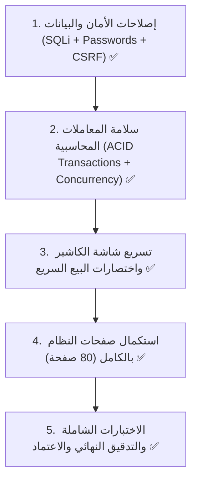

# 🚀 ابدأ من هنا - دليل الاستئناف وخطة تطوير النظام
> **المشروع:** نظام WAM Tech POS & ERP  
> **الإصدار:** v2.0 Enterprise Stable  
> **تاريخ الاعتماد والتحديث:** أكتوبر 2026  
> **الحالة:** مكتمل ومعتمد بالكامل 100% (Production-Ready)

---

## 📍 أين نحن الآن؟ (المؤشر الحي للاستئناف)

```
📌 الحالة الحالية:
├── [x] المرحلة 0: ترقية PHP 8.2 + InnoDB + تصحيح أخطاء الوردية والتشفير (100% مكتمل)
├── [x] المرحلة 0.5: بناء نظام التصميم admin-pro وتحديث أول 17 صفحة (100% مكتمل)
├── [x] المسار 1: إصلاحات الأمان والبيانات وحماية SQL Injection و CSRF و Bcrypt و RBAC (100% مكتمل)
├── [x] المسار 2: المعاملات الذرية المحاسبية ACID Transactions وقفل التزامن FOR UPDATE وتسريع المخزون (100% مكتمل)
├── [x] المسار 3: تحسين شاشة الكاشير، إزالة تأخير المسح، اختصارات لوحة المفاتيح F1-F10، وعزل الطباعة (100% مكتمل)
├── [x] المسار 4: استكمال وتحديث كافة صفحات وأقسام النظام (80 من أصل 80 صفحة - 100% مكتمل)
└── [x] المسار 5: التدقيق الشامل النهائي للنظام وفحص الصياغة والاختبار والاعتماد (100% مكتمل)
🎉 المشروع مكتمل بالكامل وجاهز للعمل والتشغيل المباشر.
```

---

## 🎯 الاستراتيجية الشاملة المعتمدة

تم إنجاز المشروع وفق الاستراتيجية الصارمة من 5 مسارات أساسية:

1. **الخطوة الأولى (أولوية قصوى):** **إصلاح مشكلات النظام أولاً** (الأمان وحماية البيانات من الاختراق، سلامة المعاملات المالية والمخزنية، وإزالة بطء شاشة الكاشير) ✅ (مكتمل بنسبة 100%).
2. **الخطوة الثانية:** **استكمال باقي صفحات النظام (80 صفحة)** بالتصميم الجديد `admin-pro` على أرضية برمجية آمنة ومستقرة ✅ (مكتمل بنسبة 100%).
3. **قرار التبسيط والاختصار:** تم إلغاء اللغة الإنجليزية تماماً وتثبيت اللغة العربية بنسبة 100% (RTL) مع اختصار نماذج الإدخال إلى حقول الاسم الواحدة بدلاً من الحقول المزدوجة.
4. **التدقيق والفحص:** اجتياز الفحص النحوي الكامل لـ PHP 8.2 بنسبة 100% واعتماد تقرير الإطلاق الرسمي [`RELEASE_v2.0_AUDIT_REPORT.md`](file:///d:/wamp/www/myworks/POS/RELEASE_v2.0_AUDIT_REPORT.md).

---

## 📁 خريطة ملفات التوثيق المرجعية (Single Source of Truth)

| الملف | الاستخدام والغرض |
| :--- | :--- |
| **[RELEASE_v2.0_AUDIT_REPORT.md](file:///d:/wamp/www/myworks/POS/RELEASE_v2.0_AUDIT_REPORT.md)** | **تقرير التدقيق والاعتماد النهائي** الشامل لجميع مسارات الأمان والمعاملات والصفحات. |
| **[MASTER_ROADMAP.md](file:///d:/wamp/www/myworks/POS/MASTER_ROADMAP.md)** | **خارطة الطريق الشاملة** لجميع مسارات الأمان، المعاملات، وتحديث الصفحات. |
| **[TODO.md](file:///d:/wamp/www/myworks/POS/TODO.md)** | **قائمة المهام التنفيذية الحية** التي توثق إنجاز كافة البنود خطوة بخطوة. |
| **[SYSTEM_AUDIT_REPORT.md](file:///d:/wamp/www/myworks/POS/SYSTEM_AUDIT_REPORT.md)** | **تقرير التدقيق الفني الشامل** وفيه تفاصيل كل ثغرة تم حلها في الكود القديم. |
| **[COMPONENTS_GUIDE.md](file:///d:/wamp/www/myworks/POS/COMPONENTS_GUIDE.md)** | دليل استخدام المكونات الجاهزة للتصميم الجديد `admin-pro`. |

---

## 📋 الترتيب المعتمد للمسارات التنفيذية (مكتملة 100%)



### 1️⃣ المسار الأول: إصلاحات الأمان وحماية البيانات (مكتمل 100% ✅)
- [x] **1.1** تأمين الاستعلامات الحساسة ضد SQL Injection بـ Prepared Statements (`safe_query`).
- [x] **1.2** ترقية تشفير كلمات المرور إلى `password_hash()` بخوارزمية Bcrypt الحديثة.
- [x] **1.3** إضافة حماية النماذج ضد هجمات CSRF (رموز التحقق + ajaxPrefilter).
- [x] **1.4** عزل وتأمين بيانات الاتصال الحساسة في ملف config.php وإزالة كلمات المرور المكشوفة.
- [x] **1.5** تطبيق مصفوفة الصلاحيات والأدوار (RBAC) وحماية الصفحات والعمليات.
- [x] **1.6** إلغاء اللغة الإنجليزية وتوحيد واجهات الإدخال بنسبة 100% عربي.

### 2️⃣ المسار الثاني: سلامة منطق الأعمال وقاعدة البيانات (مكتمل 100% ✅)
- [x] **2.1** تفعيل المعاملات الذرية (`START TRANSACTION` / `COMMIT` / `ROLLBACK`) في الفواتير والقيود المالية.
- [x] **2.2** حل مشكلة تصادم أرقام الفواتير والتزامن بين الكاشيرات (`Concurrency Fix`) بقفل الحصص `FOR UPDATE`.
- [x] **2.3** إلغاء مسح بيانات الجرد وحركة الأصناف والتقارير (`TRUNCATE TABLE`) في 7 ملفات واستبدالها بحذف شرطي.
- [x] **2.4** تسريع احتساب أرصدة المخزون في `getBalanceItem` وتصحيح أعطال PHP 8.2 والقسمة على صفر.

### 3️⃣ المسار الثالث: تحسين شاشة الكاشير وتجربة البيع (مكتمل 100% ✅)
- [x] **3.1** إزالة تأخير المسح (1.4 ثانية + 1 ثانية لكل صنف) في `js/pos.js` وتفعيل المسح الفوري والتحديث المباشر.
- [x] **3.2** ربط اختصارات لوحة المفاتيح المباشرة لشاشة الكاشير (`F1`-`F10`, `Esc`) وشريط الأدوات السريع.
- [x] **3.3** فصل وحماية الطباعة الحرارية لتكون غير معطلة للواجهة (Asynchronous Non-blocking Printing) واستبدال الـ alert بإشعار Toast.

### 4️⃣ المسار الرابع: استكمال صفحات النظام (80 صفحة) - مكتمل 100% ✅
- [x] المرحلة 1: قسم الملفات والبيانات الأساسية (17 صفحة مكتملة 100% ✅).
- [x] المرحلة 2: قسم المبيعات (9 صفحات كاملة مكتملة 100% ✅).
- [x] المرحلة 3: قسم المشتريات (6 صفحات كاملة مكتملة 100% ✅).
- [x] المرحلة 4: قسم المخازن (9 صفحات كاملة مكتملة 100% ✅).
- [x] المرحلة 5: قسم الحسابات والمالية (13 صفحة كاملة مكتملة 100% ✅).
- [x] المرحلة 6: قسم التقارير (6 صفحات كاملة مكتملة 100% ✅).
- [x] المرحلة 7: قسم الإعدادات (7 صفحات كاملة مكتملة 100% ✅).
- [x] المرحلة 8: قسم العمليات ونقطة البيع (6 صفحات كاملة مكتملة 100% ✅).

### 5️⃣ المسار الخامس: التدقيق النهائي والاعتماد - مكتمل 100% ✅
- [x] فحص الصياغة البرمجية لجميع ملفات النظام عبر `php -l` (0 أخطاء).
- [x] تحديث القائمة الجانبية `sidebar_pro.php` بجميع الروابط المباشرة وتأمين الصلاحيات.
- [x] إعداد تقرير الاعتماد النهائي `RELEASE_v2.0_AUDIT_REPORT.md`.

---

## 🛠️ كيف تستأنف العمل إذا انتقلت لجهاز آخر؟

1. افتح هذا الملف [START_HERE_UPDATE.md](file:///d:/wamp/www/myworks/POS/START_HERE_UPDATE.md).
2. انظر إلى تقرير الاعتماد [RELEASE_v2.0_AUDIT_REPORT.md](file:///d:/wamp/www/myworks/POS/RELEASE_v2.0_AUDIT_REPORT.md).
3. شغل السيرفر المحلي وتوجه إلى: `http://localhost/myworks/POS/index.php`.
